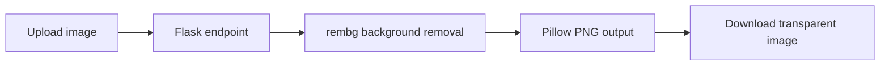

# Background Remover

A lightweight web app that removes the background from an uploaded image and returns a transparent PNG.

## Features
- Upload an image through a simple web interface
- Remove the background using `rembg`
- Return the processed image as a downloadable PNG
- Flask-based backend with a Gunicorn start command

## Tech Stack
Python · Flask · rembg (CPU) · Pillow · Gunicorn

## Run Locally
```bash
git clone https://github.com/SujalRevankar/Background-Remover.git
cd Background-Remover
python -m venv .venv
# Windows: .venv\Scripts\activate
# macOS/Linux: source .venv/bin/activate
pip install -r requirements.txt
python app.py
```

Open the local URL printed by Flask in your browser.

## How It Works


## Deployment
A Render service configuration is included in `render.yaml`; dependencies are installed from `requirements.txt` and the app is served with Gunicorn.

## Main Files
- `app.py` – Flask routes and image processing
- `templates/index.html` – Web interface
- `requirements.txt` – Python dependencies
- `render.yaml` – Render deployment configuration
